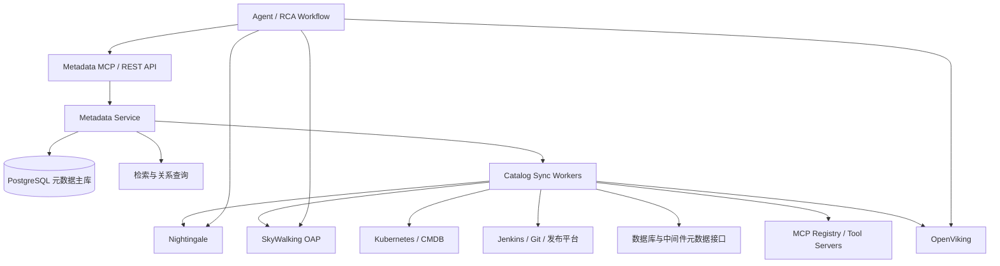
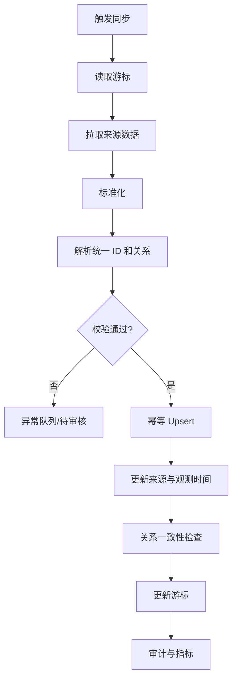
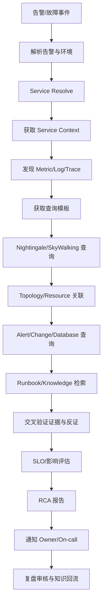

# AIOps Metadata Catalog（智能运维元数据中心）方案

**版本：V1.0**  
**目标：** 为 Agent 驱动的 AIOps、RCA 和 SRE 平台建设统一、可检索、可关联、可审计的结构化元数据中心。

## 1. 建设目标与架构边界

Metadata Catalog 解决 Agent 在 RCA 时“不知道有哪些服务、资源、指标、日志索引、Trace、变更、工具和负责人”的问题。它保存结构化元数据、来源标识、关系、查询模板和能力描述，不复制 Prometheus 时序、ES 日志正文或 SkyWalking Trace 原始数据。

核心原则：

1. `service_id` 是跨目录关联的核心主键。
2. 保留来源系统原始 ID、名称和标签，不以规范化字段覆盖原始事实。
3. 每条自动同步记录必须有来源、观测时间、同步时间和状态。
4. 静态依赖、运行时调用、人工确认、Agent 推断必须区分。
5. 自动发现不等于可信，支持待审核、过期、废弃和禁用状态。
6. Agent 只能使用已登记的查询模板和已授权工具；MCP 暴露不等于生产写权限。
7. OpenClaw 是可替换的 Agent Runtime，Catalog API/MCP 不依赖某个 Runtime。
8. 证据优先，时间相关不等于因果；允许 RCA 输出“证据不足，无法确定”。

### 1.1 目录清单

| 目录 | 职责 | 优先级 |
|---|---|---|
| Service Catalog | 服务统一身份和主索引 | P0 |
| Resource Catalog | 主机、K8s、容器、中间件等资产 | P0 |
| Topology Catalog | 服务依赖、部署关系、运行时调用拓扑 | P0 |
| Metric Catalog | 指标发现、语义、标签、PromQL 模板 | P0 |
| Log Catalog | ES 索引、字段、时间字段、日志查询模板 | P0 |
| Tool Capability Catalog | MCP 工具能力、Schema、权限和风险 | P0 |
| Alert Catalog | 告警规则、级别、指标和服务关联 | P1 |
| Trace Catalog | Trace 数据源、Endpoint、Span 字段和查询入口 | P1 |
| Change Catalog | 发布、Commit、制品、配置和基础设施变更 | P1 |
| Database Catalog | 数据库实例、Schema、表和应用依赖 | P1 |
| Runbook / Knowledge Catalog | 已审核 SOP、Runbook、组件知识、RCA | P1 |
| SLO Catalog | SLI、SLO、错误预算、Burn Rate | P2 |
| Ownership Catalog | 服务 Owner、团队、On-call、升级和审批人 | P2 |

### 1.2 总体架构



| 组件 | 负责内容 | 边界 |
|---|---|---|
| Metadata Service | 结构化目录、关系、映射、查询模板、能力策略 | 不存监控原始数据 |
| Nightingale | 指标、告警、ES 日志统一查询 | 不作为所有资产的主数据管理系统 |
| SkyWalking | 运行时服务拓扑、Trace、Span | 不替代静态 CMDB |
| Jenkins/发布平台 | Job、Build、Commit、制品、发布 | 不推断变更因果 |
| CMDB/K8s | 资源资产和运行状态 | 不替代统一 service_id |
| OpenViking | 语义知识、Runbook 正文、历史 RCA | 不作为结构化资产和权限主库 |
| MCP Server | 提供受控工具接口 | 工具可见不代表可执行写操作 |
| OpenClaw | 当前 Agent Runtime | 可替换，不承载目录主数据 |

## 2. 通用数据模型与基础设施

### 2.1 公共字段规范

目录实体建议按需包含以下公共字段：

| 字段 | 类型/示例 | 说明 |
|---|---|---|
| `id` | UUID/雪花 ID | Catalog 内部主键 |
| `tenant_id` | varchar | 多租户隔离；单租户可固定默认值 |
| `environment` | prod/staging/test | 环境 |
| `region` / `cluster` | bj4 / k8s-prod | 位置与集群 |
| `service_id` | svc-order-api | 关联服务 |
| `source_system` | cmdb/k8s/nightingale | 来源系统 |
| `source_key` | 来源原始 ID | 来源唯一标识 |
| `source_version` | 版本/资源版本 | 来源变更追踪 |
| `status` | active/stale/deprecated/disabled | 生命周期状态 |
| `first_seen_at` | timestamptz | 首次发现 |
| `last_seen_at` | timestamptz | 最近发现 |
| `sync_time` | timestamptz | 最近同步 |
| `labels` | JSONB | 扩展标签 |
| `created_at/updated_at` | timestamptz | 内部创建和更新时间 |

高频过滤字段应建独立列和索引，不要全部塞入 JSONB。

### 2.2 统一标识与别名映射

建议内部 ID 稳定、可读且不可随展示名变化：

- `service_id`：如 `svc-order-api`
- `resource_id`：如 `res-prod-bj4-node-001`
- `metric_id`：内部指标 ID，保留原始 `metric_name`
- `log_source_id`：内部日志源 ID，保留 ES index/data stream
- `trace_source_id`：内部 Trace 数据源 ID
- `tool_id`：内部工具能力 ID，保留 MCP 原始 server/tool 名
- `knowledge_id`：知识 ID，正文可放 OpenViking

服务别名表 `catalog_service_alias` 至少包含：

`service_id, alias_type, alias_value, environment, cluster, source_system, match_method, confidence, verified, valid_from, valid_to`

Alias 类型示例：`cmdb_code`、`k8s_label`、`skywalking_service`、`jenkins_job`、`es_index`、`nightingale_group`。

**禁止仅凭模糊名称静默合并服务。** 多候选或低置信度匹配进入待确认队列。

### 2.3 推荐技术选型

| 层次 | 建议 |
|---|---|
| 元数据主库 | PostgreSQL 16+；也可使用现有 MySQL |
| 扩展字段 | PostgreSQL JSONB |
| 初期检索 | PostgreSQL 索引和全文检索 |
| 知识正文 | OpenViking |
| 缓存 | Redis，可选 |
| 同步任务 | Python Worker + 定时任务/消息队列 |
| 服务接口 | REST/JSON |
| Agent 接口 | 一个统一 Metadata MCP |
| 管理界面 | 审核、映射、禁用、版本比较 |

初期不要按目录拆成十几个微服务，也不要给每个目录单独建设 MCP。

### 2.4 基础表参考

```sql
CREATE TABLE catalog_service (
  service_id varchar(128) PRIMARY KEY,
  service_name varchar(256) NOT NULL,
  service_type varchar(64),
  business_domain varchar(128),
  description text,
  criticality varchar(32),
  owner_team varchar(128),
  environment varchar(32) NOT NULL,
  region varchar(64),
  lifecycle varchar(32) DEFAULT 'active',
  status varchar(32) DEFAULT 'active',
  source_system varchar(64),
  source_key varchar(256),
  first_seen_at timestamptz,
  last_seen_at timestamptz,
  created_at timestamptz DEFAULT now(),
  updated_at timestamptz DEFAULT now()
);

CREATE TABLE catalog_service_alias (
  id bigserial PRIMARY KEY,
  service_id varchar(128) NOT NULL REFERENCES catalog_service(service_id),
  alias_type varchar(64) NOT NULL,
  alias_value varchar(512) NOT NULL,
  environment varchar(32),
  cluster varchar(128),
  source_system varchar(64),
  match_method varchar(32) NOT NULL,
  confidence numeric(5,4),
  verified boolean DEFAULT false,
  valid_from timestamptz DEFAULT now(),
  valid_to timestamptz
);

CREATE TABLE catalog_sync_state (
  source_system varchar(64) NOT NULL,
  object_type varchar(64) NOT NULL,
  cursor_value text,
  last_success_at timestamptz,
  last_error text,
  status varchar(32),
  updated_at timestamptz DEFAULT now(),
  PRIMARY KEY(source_system, object_type)
);

CREATE TABLE catalog_audit (
  id bigserial PRIMARY KEY,
  actor varchar(128) NOT NULL,
  action varchar(64) NOT NULL,
  object_type varchar(64) NOT NULL,
  object_id varchar(256) NOT NULL,
  before_data jsonb,
  after_data jsonb,
  reason text,
  created_at timestamptz DEFAULT now()
);
```

其他目录按下文扩展。同步写入使用 `source_system + source_key + environment` 等组合幂等键。

---

# 3. Service Catalog：服务目录

### 3.1 目标与关键字段

Service Catalog 是所有目录的主索引，负责将 CMDB、Kubernetes、Nightingale、SkyWalking、Jenkins、ES 中不同的应用名称映射到统一 `service_id`。

| 字段 | 示例 | 说明 |
|---|---|---|
| `service_id` | svc-order-api | 内部稳定 ID |
| `service_name` | 订单 API | 展示名 |
| `service_type` | backend/worker/frontend | 服务类型 |
| `business_domain` | transaction | 业务域 |
| `criticality` | critical/high/medium/low | 业务重要性 |
| `environment` | prod | 环境 |
| `region` | bj4 | 机房/地域 |
| `owner_team` | order-team | 负责人团队 |
| `repository_url` | Git URL | 代码仓库 |
| `documentation_url` | 文档 URL | 架构/接口文档 |
| `lifecycle` | active | 生命周期 |

关联表：`service_alias`、`service_tag`、`service_relation`、`service_endpoint`。

### 3.2 数据来源与同步

- CMDB：应用编码、系统、负责人、环境，优先作为服务主数据来源。
- Kubernetes：Namespace、Deployment、StatefulSet、Service、labels。
- Nightingale：业务组、监控对象标签，作为辅助映射。
- SkyWalking：Service、Service Instance。
- Jenkins/Git：Job、项目、仓库与服务映射。
- 人工后台：业务说明、关键等级、Owner。

同步流程：拉取来源对象 → Alias 精确匹配 → 未匹配进入待确认 → 已匹配幂等更新 → 更新时间 → 下线先标 stale → 审核后 deprecated。

人工确认字段应有来源优先级，防止自动同步覆盖。

### 3.3 API/MCP

- `service_search(keyword, environment, domain, criticality)`
- `service_detail(service_id)`
- `service_resolve(alias_type, alias_value, environment, cluster)`
- `service_relations(service_id, relation_type, depth)`

### 3.4 Agent 用法与治理

RCA 先解析告警标签中的 service/app/namespace/pod/instance，再调用 `service_resolve`。多候选时比较环境、集群、资源归属和来源可信度；无法唯一确定就标记 ambiguous，不可擅自合并。

服务 ID 创建后原则上不修改；改名只更新展示名和 Alias。服务合并/拆分必须保留历史映射和审计。

---

# 4. Resource Catalog：资源资产目录

### 4.1 目标与资源分类

回答服务运行在哪里、依赖哪些基础资源、异常资源影响哪些服务。

| 资源类型 | 示例 | 标识 |
|---|---|---|
| Host | Linux/Windows/麒麟主机 | asset_id、hostname |
| Kubernetes | Cluster/Node/Namespace/Pod/Deployment | cluster、namespace、UID |
| Container | Docker 容器 | container_id、host |
| Network | VIP/LB/网卡/域名 | address、network_id |
| Middleware | Redis/Kafka/Pulsar/Consul/Nginx | instance_id、endpoint |
| Storage | NFS/对象存储/云盘 | volume_id、bucket |
| Database | MySQL/OceanBase/MongoDB/Doris | db_instance_id |

### 4.2 核心字段与关系

`catalog_resource`：

`resource_id, resource_type, resource_name, environment, region, cluster, endpoint, ip_address, parent_resource_id, lifecycle_status, source_system, source_key, first_seen_at, last_seen_at`

服务与资源多对多，使用 `catalog_resource_service_rel`：

`resource_id, service_id, relation_type, valid_from, valid_to, source_system, confidence, verified`

资源层级另用 `catalog_resource_relation` 表示 Pod→Node、Container→Host、Schema→DB Instance。

### 4.3 来源与同步

- CMDB：资产 ID、主机属性、负责人。
- Kubernetes API：Watch + 周期全量校准。
- Docker API：容器状态、镜像、宿主机、标签。
- 云平台 API：云主机、磁盘、LB、网络。
- 中间件管理接口：实例、集群、Broker/节点。
- Nightingale：监控实例作为发现补充，不作为唯一资产事实。

Pod/容器使用 UID 和创建时间识别，IP 会复用，不能作为永久资源主键。短生命周期资源标记 deleted/stale，不立即物理删除。

### 4.4 API/MCP 与 Agent 用法

- `resource_search(keyword, resource_type, environment, cluster, service_id)`
- `resource_detail(resource_id)`
- `resource_by_service(service_id, resource_type)`
- `resource_relations(resource_id, depth)`

Agent 先定位服务，再查 Pod、Node、容器、数据库和中间件实例，然后调用对应只读诊断工具。密码、Token、私钥不进入 Catalog，只存 Secret 引用。

---

# 5. Topology Catalog：拓扑目录

### 5.1 目标与拓扑类型

拓扑用于 RCA 上下游影响分析，需同时维护：

- 静态拓扑：CMDB 依赖、部署归属、网关路由、消息生产消费关系。
- 运行时拓扑：SkyWalking 实际观测到的调用关系。
- 历史拓扑：关系的有效时间，支持历史 RCA。

必须区分配置声明的依赖和运行时观测调用。

### 5.2 节点/边模型

节点：service、host、node、pod、container、database、redis、kafka、pulsar、gateway、external_service。

边：`calls`、`depends_on`、`runs_on`、`connects_to`、`routes_to`、`produces_to`、`consumes_from`、`replicates_to`。

`catalog_topology_node`：

`node_id, node_type, ref_type, ref_id, service_id, environment, labels, status`

`catalog_topology_edge`：

`edge_id, source_node_id, target_node_id, relation_type, environment, valid_from, valid_to, source_system, evidence_count, confidence, status`

来源、观测时间、有效时间、证据数量和可信度必须保留。

### 5.3 来源与同步

- SkyWalking：运行时 Service、Endpoint、调用关系。
- Kubernetes：Workload、Service、Ingress、Namespace、Node。
- CMDB：业务依赖、资产归属。
- 网关/注册中心：路由和注册实例。
- 消息系统：Topic、Producer、Consumer（结合配置或运行时证据）。
- 人工维护：外部依赖、灾备关系。

统一节点 ID 后去重，但保留多来源证据；长期未观测边标记 stale，不删除历史。Agent 推断关系必须标记 inferred。

### 5.4 API/MCP 与 Agent 用法

- `topology_neighbors(service_id, direction, depth, as_of)`
- `topology_path(source_service_id, target_service_id, as_of)`
- `topology_subgraph(service_id, depth, environment, as_of)`
- `topology_changes(service_id, time_range)`

RCA 获取故障服务上下游一到两层，结合指标、Trace、日志和变更寻找传播路径。拓扑相邻仅是关联线索，不足以证明因果。限制最大深度和节点数，避免一次返回全公司拓扑。

---

# 6. Metric Catalog：指标元数据目录

### 6.1 目标与数据分层

Metric Catalog 解决 Agent 不知道指标名称、含义、标签和 PromQL 写法的问题。**Catalog 负责发现和解释，Nightingale 负责实际查询。**

指标元数据分为：
1. 定义：名称、类型、HELP、单位。
2. 语义：中文描述、分类、组件、服务。
3. 查询：标签 Schema、PromQL 示例、参数化模板。
4. 治理：最近出现时间、基数风险、可信状态、启停状态。

### 6.2 核心字段

| 字段 | 示例 | 说明 |
|---|---|---|
| `metric_id` | 内部 ID | 主键 |
| `metric_name` | http_server_requests_total | 原始指标名 |
| `metric_type` | counter/gauge/histogram/summary | 类型 |
| `help` | Exporter HELP | 原始说明 |
| `display_name` | HTTP 请求总数 | 展示名 |
| `description_zh` | 服务端请求累计次数 | 中文语义 |
| `category` | http/jvm/cpu/pulsar | 分类 |
| `component` | springboot/node_exporter | 组件 |
| `service_id` | svc-order-api | 服务关联 |
| `unit` | requests/seconds/bytes | 单位 |
| `labels_schema` | JSON | 标签名、含义、示例、敏感性 |
| `promql_examples` | JSON | 审核示例 |
| `query_template` | JSON | 参数化模板 |
| `last_seen_at` | 时间 | 最近出现 |
| `enabled` | true | 是否允许 Agent 使用 |
| `trust_level` | verified/discovered/deprecated | 可信等级 |
| `cardinality_level` | low/medium/high | 基数风险 |

### 6.3 数据发现与同步

使用 Prometheus 兼容 API（可对接 Nightingale 后端）：

- `/api/v1/label/__name__/values`：指标名。
- `/api/v1/metadata`：HELP、TYPE。
- `/api/v1/series`：时间范围内的序列和标签。
- `/api/v1/query`：即时查询。
- `/api/v1/query_range`：区间查询。

同步步骤：拉取指标名和 metadata → 去重 → 获取有限时间范围 Series 标签 → 统计标签 Schema/近似基数/最近出现时间 → 根据前缀和来源识别组件 → 根据 Job/Instance/K8s labels/服务 Alias 映射 service_id → 未识别项待补充 → 审核描述、单位和查询模板。

不长期保存完整 Label Set，只保留 Schema、有限样例和基数摘要。

### 6.4 PromQL 模板治理

建议模板参数化，而不是保存任意自由文本：

```json
{
  "template_id": "http_error_ratio",
  "purpose": "HTTP 5xx 错误率",
  "expression": "sum(rate(http_server_requests_total{status=~\"5..\"}[5m])) / clamp_min(sum(rate(http_server_requests_total[5m])), 1)",
  "parameters": {"window": {"type": "duration", "default": "5m"}},
  "unit": "ratio",
  "risk_level": "low",
  "review_status": "verified"
}
```

真实环境需按实际标签修订，不能假设所有指标都有 service 标签。参数必须白名单校验，禁止直接拼接任意 PromQL 片段。

工具链：
- `metric_search(keyword, service_id, category, component)`
- `metric_detail(metric_id_or_name)`
- `metric_suggest(service_id, symptom, time_range)`
- `metric_query(template_id, parameters, start, end, step)`

`metric_query` 由 Nightingale 适配层执行，记录表达式、参数、时间窗、耗时、结果状态和调用者。

### 6.5 质量治理与 Agent 流程

治理 HELP/TYPE/单位/中文描述缺失；识别 user_id、trace_id、request_id 等高基数标签；长时间未出现标 stale；Histogram 的 bucket/sum/count 按整体语义管理；Counter 通常使用 rate/increase，Gauge 根据语义选择聚合。

Agent：按服务和症状搜索指标 → 获取标签与模板 → 填充环境和服务参数 → 调 Nightingale → 对比故障前基线/故障窗口/恢复窗口 → 把查询条件和结果摘要写入 Evidence。

---

# 7. Log Catalog：日志元数据目录

### 7.1 目标与核心实体

Log Catalog 让 Agent 知道日志在哪里、时间字段是什么、可检索字段有哪些、如何按服务/实例/Trace ID 检索。日志正文仍在 Elasticsearch，查询统一走 Nightingale。

`catalog_log_source` 字段：

`log_source_id, source_name, backend, index_pattern, environment, service_id, time_field, timestamp_format, default_query_window, retention_days, routing_fields, trace_id_field, level_field, message_field, status`

`catalog_log_field` 字段：

`log_source_id, field_name, field_type, description, is_searchable, is_aggregatable, is_sensitive, sample_values, last_seen_at`

### 7.2 来源与同步

- ES Index Template/Component Template：字段定义。
- ES Data Streams/Indices API：索引和生命周期。
- ES Field Caps：字段类型及跨索引兼容性。
- ES Mapping：字段映射。
- Nightingale：日志查询入口、租户/业务组和路由。
- 应用日志规范：Trace ID、service、environment、instance。

同步：读取模板/Mapping/Data Stream → 字段类型归一化 → 检测类型冲突 → 根据索引规则和字段映射 service_id → 记录时间字段、Trace ID 字段等 → 样例脱敏 → 未映射索引待确认。

### 7.3 查询模板和 API

```json
{
  "template_id": "service_error_logs",
  "log_source_id": "logs-order-prod",
  "filters": [
    {"field": "service.name", "operator": "eq", "parameter": "service_name"},
    {"field": "log.level", "operator": "in", "value": ["ERROR", "FATAL"]},
    {"field": "@timestamp", "operator": "range", "parameter": "time_range"}
  ],
  "limit": 200,
  "review_status": "verified"
}
```

API/MCP：
- `log_source_search(service_id, environment, keyword)`
- `log_source_detail(log_source_id)`
- `log_field_search(log_source_id, keyword)`
- `log_query_suggest(service_id, symptom, time_range)`
- `log_query(template_id, parameters, time_range, limit)`

字段必须白名单校验，限制时间范围、返回条数、超时和并发；禁止任意跨库 wildcard/regexp 查询。日志正文视为不可信输入，可能含敏感数据或提示注入内容，必须脱敏，不能执行日志中的指令。

### 7.4 Agent 用法

按 service_id 找日志源和字段；优先 trace_id、service、pod、host、level 精确过滤；先聚合错误类型，再取有限样本；查询通过 Nightingale 统一入口执行。

---

# 8. Tool Capability Catalog：工具能力目录

### 8.1 目标

这是 Agent 的能力地图和治理入口，描述有哪些 MCP/工具、支持什么操作、参数 Schema、环境范围、权限、风险、审批和健康状态。**工具暴露不等于生产授权。**

`catalog_tool_server`：
`server_id, server_name, protocol, endpoint_ref, owner_team, version, environment_scope, auth_type, health_status, last_health_check, network_zone, enabled`

`catalog_tool_capability`：
`tool_id, server_id, tool_name, display_name, description, input_schema, output_schema, operation_type, access_mode, risk_level, environment_scope, approval_required, idempotent, timeout_seconds, rate_limit, allowed_roles, data_classification, enabled, schema_version`

### 8.2 风险等级

| 等级 | 示例 | Agent 策略 |
|---|---|---|
| L0 | Catalog 搜索、帮助 | 自动允许 |
| L1 | 指标、日志、Trace、资源只读 | 范围和预算内自动允许 |
| L2 | 受限诊断脚本、只读 SQL | 白名单和参数校验 |
| L3 | 重启、扩容、配置修改、发布/回滚 | 审批、审计、回滚预案 |
| L4 | 删除数据、清库、销毁资源 | 默认禁止 Agent 自动执行 |

按具体 Tool 划分风险，不按 MCP Server 整体划分。

### 8.3 来源、同步与 API

- MCP `tools/list`：发现工具名、描述、JSON Schema。
- 配置仓库：版本、环境、网络范围。
- 权限系统：角色和资源范围。
- 管理后台：风险等级、Owner、审批要求。
- 健康检查：可用性和最近成功调用。

Schema 可自动发现，但风险等级、生产权限、审批要求必须审核；Schema 变更要版本化并触发回归。

API/MCP：
- `tool_search(keyword, operation_type, access_mode, environment)`
- `tool_detail(tool_id)`
- `tool_schema(tool_id, version)`
- `tool_capabilities_for_task(task_type, environment)`
- `tool_policy_check(tool_id, principal, parameters, target_resource)`
- `tool_health(tool_id)`

Policy Check 返回 `allow/deny/require_approval`、命中策略、原因和策略版本。Agent 调用前检查；写操作生成审批请求，批准后由受控执行服务执行。审计绑定任务 ID、RCA ID、用户身份、参数摘要和结果摘要。

### 8.4 安全要求

工具白名单、参数 Schema、目标资源范围、生产/非生产凭据隔离、Secret 引用、超时/并发/速率限制、审批、双人复核（按风险）、操作前检查、回滚预案和不可抵赖审计。工具输出也视为不可信数据。

---

# 9. Alert Catalog：告警目录

### 9.1 目标与字段

管理告警规则定义、来源、指标/服务关联、级别和 Runbook；不替代 Nightingale 的规则执行与事件管理。

`catalog_alert_rule`：
`alert_rule_id, source_rule_id, rule_name, description, severity, expression, metric_ids, service_id, labels_schema, for_duration, evaluation_interval, notification_policy_ref, runbook_id, owner_team, enabled, status, rule_version, effective_from`

告警规则定义与告警事件实例分开。事件实例只保存必要索引和来源 ID，原始事件仍由 Nightingale 管理。

### 9.2 来源与同步

从 Nightingale API/配置导出规则和分组；解析表达式引用指标；根据规则标签和 Alias 映射 service_id；关联 Metric Catalog、Runbook；记录版本和启停状态；未识别规则进入待治理。

### 9.3 API/MCP 与 Agent

- `alert_rule_search(keyword, service_id, severity)`
- `alert_rule_detail(alert_rule_id)`
- `alert_rules_by_service(service_id)`
- `alert_related_metrics(alert_rule_id)`
- `alert_runbook(alert_rule_id)`

Agent 收到告警后先定位规则详情，提取服务、指标、阈值、持续时间和标签，再查指标语义、拓扑和 Runbook。规则变更必须版本化，生产规则修改不得由 Agent 未经审批执行。

---

# 10. Trace Catalog：链路元数据目录

### 10.1 目标与字段

管理 Trace 数据源、服务命名映射、Endpoint、Span 字段语义和查询入口。Trace 原始数据留在 SkyWalking；运行时拓扑由 SkyWalking 提供，Catalog 负责发现与解释。

`catalog_trace_source`：
`trace_source_id, backend, oap_endpoint_ref, environment, cluster, service_id, service_name_raw, trace_id_format, query_capabilities, retention_days, status`

`catalog_trace_endpoint`：
`endpoint_id, service_id, endpoint_name, operation_type, span_kind, protocol, normalization_rule, last_seen_at, source_system`

Span 字段目录：
`field_name, field_type, description, semantic_type, sensitive, searchable`

### 10.2 来源与同步

SkyWalking OAP API/GraphQL 提供 Service、Instance、Endpoint、Trace 查询；OTel Semantic Conventions 提供标准字段语义；应用埋点规范提供自定义 Tag；Service Catalog 负责统一 service_id 映射。

周期同步服务、Endpoint 和字段 Schema；不复制完整 Trace，只保存必要的脱敏统计和引用。

### 10.3 API/MCP 与 Agent

- `trace_source_search(service_id, environment)`
- `trace_service_detail(service_id)`
- `trace_endpoint_search(service_id, keyword)`
- `trace_query_suggest(service_id, symptom, time_range)`
- `trace_query(trace_source_id, filters, time_range, limit)`

实际查询由 SkyWalking MCP 执行。Agent 有 Trace ID 时优先精确查；无 Trace ID 时按服务、Endpoint、时间和错误状态筛选，沿 Span 父子关系分析耗时并与指标、日志、变更交叉验证。

---

# 11. Change Catalog：变更目录

### 11.1 目标与变更类型

统一应用发布、代码提交、制品、配置、数据库结构、基础设施、网络和人工操作记录。时间接近仅是线索，不代表因果。

类型：`application_release`、`rollback`、`config_change`、`database_schema_change`、`infrastructure_change`、`network_change`、`middleware_change`、`manual_operation`。

### 11.2 核心字段

`catalog_change`：
`change_id, change_type, service_id, resource_ids, environment, cluster, project, job_name, build_id, commit_sha, artifact, version_from, version_to, started_at, completed_at, operator, approval_id, result, rollback_of, change_summary, source_system, source_key`

### 11.3 来源与同步

- Jenkins：Job、Build、参数、Commit、制品、执行人、结果。
- Git：Commit、PR/MR、标签、分支。
- Kubernetes：Deployment/StatefulSet rollout、镜像版本。
- 发布平台：审批单、发布单、灰度范围、结果。
- 配置中心：配置版本和变更摘要。
- 云平台/审计系统：基础设施和人工操作。

事件驱动优先，定时补偿兜底。统一关联 service_id/resource_id。

### 11.4 API/MCP 与 Agent

- `change_search(service_id, environment, time_range, change_type)`
- `change_detail(change_id)`
- `changes_around(timestamp, service_id, before, after)`
- `change_by_commit(commit_sha)`
- `change_impact(change_id)`

RCA 查询故障前 30 分钟、1 小时、24 小时等分层窗口；对比变更前后指标、错误率、Trace、日志。需验证影响对象、版本差异和异常机制；Jenkins Build 成功不能等同于生产发布成功。生产变更必须有唯一变更 ID，统一 UTC 存储时间。

---

# 12. Database Catalog：数据库目录

### 12.1 目标与目录层级

管理数据库资产和应用依赖，使 Agent 知道服务使用哪些数据库、连接哪个实例、有哪些逻辑库/表、有哪些真实可用的只读诊断入口。

层级：Database Engine → Cluster/Tenant → Instance → Database/Schema → Table/Object → Application Binding。

**能力边界必须真实。** 如果当前 dbx-mcp 只支持实例/数据源/资产信息查询，就不能假设它支持慢 SQL、锁、会话诊断或任意 SQL 执行。

### 12.2 核心字段

`catalog_database_instance`：
`db_instance_id, db_type, db_version, cluster_id, instance_role, endpoint_ref, port, environment, region, tenant, availability_status, source_system`

`catalog_database_schema`：
`schema_id, db_instance_id, schema_name, charset, collation`

`catalog_database_object`：
`object_id, schema_id, object_type, object_name, engine, partition_info, estimated_rows, last_ddl_time`

`catalog_database_service_rel`：
`service_id, db_instance_id, schema_id, access_type, connection_alias, source_system, confidence, verified`

### 12.3 来源与同步

- CMDB：实例、集群、负责人、环境。
- dbx-mcp：按实际支持能力同步实例/数据源信息。
- 只读元数据连接器：授权后查询版本、Schema、Table、Column。
- K8s Secret/配置中心：只提取数据源引用关系，不导出凭据。
- 应用配置：辅助建立服务和数据库绑定。

表结构同步需控制频率和范围，避免给生产库增加负载。敏感字段只保存字段名和分类，不采集真实数据样本。密码不入库，只保存 Secret 引用。

### 12.4 API/MCP 与 Agent

- `database_search(db_type, environment, service_id)`
- `database_instance_detail(db_instance_id)`
- `database_by_service(service_id)`
- `database_schema_search(db_instance_id, keyword)`
- `database_object_detail(object_id)`
- `database_capabilities(db_instance_id)`

发现数据库依赖不等于拥有 SQL 诊断能力。没有对应接口时，应明确说明能力缺失，不得生成虚假诊断结论。

---

# 13. Runbook / Knowledge Catalog：知识目录

### 13.1 目标与分类

结构化元信息放 Catalog，正文和向量检索内容放 OpenViking。

知识类型：Runbook、Troubleshooting、Architecture、Component Knowledge、RCA Case、SOP、Policy。

### 13.2 核心字段

`catalog_knowledge`：
`knowledge_id, title, knowledge_type, service_id, component, environment_scope, version_scope, symptoms, tags, openviking_uri, owner_team, review_status, reviewer, reviewed_at, valid_from, valid_until, supersedes_id, risk_level, last_verified_at`

### 13.3 入库与审核

来源：运维文档、官方组件文档、内部 SOP、已审核 RCA、经过验证的脚本说明。

流程：解析去重 → 切分和提取元数据 → 生成 OpenViking URI → draft/pending → 组件 Owner/SRE 审核 → approved → 版本变化或验证失败时复核。

未经验证的 Agent 输出、临时推测和未复盘聊天内容不能直接进入可信知识库。可作为待审核候选，但必须与 approved 集合隔离。

### 13.4 API/MCP 与 Agent

- `knowledge_search(query, service_id, component, knowledge_type, version)`
- `knowledge_detail(knowledge_id)`
- `runbook_for_alert(alert_rule_id)`
- `runbook_for_symptom(service_id, symptom)`
- `knowledge_related_rca(service_id, component)`

Agent 优先检索审核通过且版本匹配的 Runbook。Runbook 写有重启步骤，不代表 Agent 获得重启权限；仍需 Tool Capability 和审批策略授权。

---

# 14. SLO Catalog：可靠性目录

### 14.1 目标与概念

把监控指标与业务可靠性目标关联，让 Agent 能判断异常对用户体验和错误预算的影响。

- SLI：成功请求率、延迟分位数、可用性等。
- SLO：指定时间窗内 SLI 目标。
- Error Budget：允许的不可靠性额度。
- Burn Rate：错误预算消耗速度。
- SLA：对外合同承诺，不应与内部 SLO 混用。

### 14.2 核心字段

`catalog_slo`：
`slo_id, service_id, slo_name, objective_type, target_value, comparison_operator, window, sli_definition, good_event_query_ref, total_event_query_ref, metric_template_id, error_budget_policy, criticality, effective_from, effective_to, owner_team, status`

`catalog_slo_policy` 保存多窗口告警阈值、Burn Rate 和处置策略。

### 14.3 来源、计算和 API

SLO 定义由 SRE/业务 Owner 审核；SLI 通过 Nightingale 指标模板计算；告警来自 Nightingale 或 SLO 计算任务。保存计算公式版本和按时间窗口的结果，不能只保存当前错误预算百分比。

- `slo_by_service(service_id)`
- `slo_detail(slo_id)`
- `slo_status(slo_id, time_range)`
- `slo_burn_rate(service_id, time_range)`
- `slo_impact(service_id, incident_window)`

RCA 报告加入服务 SLO、当前错误预算、Burn Rate 和影响窗口，优先级结合用户影响和预算消耗评估。

---

# 15. Ownership Catalog：责任与值班目录

### 15.1 目标与核心实体

管理服务负责人、团队、当前 On-call、升级路径和生产操作审批关系。

实体：Team、Person（企业身份引用）、Service Ownership、On-call Schedule、Escalation Policy、Approval Role。

`catalog_ownership`：
`service_id, owner_team_id, primary_owner_id, backup_owner_id, oncall_schedule_ref, escalation_policy_id, approval_group_id, valid_from, valid_to, source_system, verified_at`

### 15.2 来源与同步

- 企业组织/身份系统：团队和人员。
- 值班平台：当前 On-call 和轮班。
- CMDB：服务 Owner。
- 审批系统：审批组和授权范围。
- 管理后台：异常映射修订。

值班信息具有时效性，应查询实时或近期有效数据；过期缓存不能冒充当前值班人。人员信息最小化存储，优先使用企业账号 ID，不保存不必要的私人联系方式。

### 15.3 API/MCP 与 Agent

- `ownership_by_service(service_id, at_time)`
- `team_detail(team_id)`
- `oncall_current(team_id, at_time)`
- `escalation_path(service_id, severity)`
- `approval_policy(operation_type, environment, resource_id)`

RCA 完成后按服务 Owner 通知；严重故障按升级路径处理；生产写操作审批人必须来自正式审批策略，不能由模型自行选择。

---

# 16. Metadata Service：统一 API/MCP 设计

### 16.1 统一服务而不是多个独立 MCP

建议一个 Metadata Service，内部按 Domain 模块化，对外提供 REST API 和一个 Metadata MCP，统一鉴权、过滤、分页、审计、限流和 Schema 版本。

### 16.2 API 分层

| 层次 | 示例 | 用途 |
|---|---|---|
| Search | `/services/search`、`/metrics/search` | 发现 |
| Detail | `/services/{id}`、`/metrics/{id}` | 详情 |
| Relation | `/services/{id}/relations` | 关系 |
| Resolve | `/resolve` | 来源标识解析 |
| Suggest | `/metrics/suggest`、`/logs/suggest` | 查询建议 |
| Capability | `/tools/capabilities` | 能力发现 |
| Policy | `/tools/policy-check` | 权限检查 |
| Admin | `/admin/catalog/...` | 审核维护 |
| Sync | `/admin/sync/...` | 同步控制 |

通用过滤：`environment`、`tenant_id`、分页、时间范围和审计上下文。

### 16.3 Metadata MCP 工具

- `catalog_search(domain, keyword, filters)`
- `catalog_detail(domain, object_id)`
- `catalog_resolve(source_type, source_key, environment, cluster)`
- `catalog_relations(object_type, object_id, relation_types, depth, as_of)`
- `catalog_context_for_service(service_id, environment, time_range)`
- `catalog_discover_capabilities(task_type, environment)`
- `catalog_policy_check(tool_id, principal, target, parameters)`

`catalog_context_for_service` 是 RCA 关键入口，可返回服务、资源摘要、指标/日志/Trace 入口、告警、变更、SLO、Owner 和 Runbook 引用；必须限制字段和响应大小，不返回大量原始观测数据。

### 16.4 响应结构

```json
{
  "request_id": "req-xxxx",
  "data": {},
  "meta": {
    "source_system": ["cmdb", "nightingale"],
    "observed_at": "2026-11-16T08:00:00Z",
    "catalog_version": "v1",
    "stale": false,
    "confidence": 1.0
  },
  "warnings": []
}
```

不确定映射应返回候选、匹配依据和置信度。

### 16.5 权限与审计

Agent 身份、用户身份、工具执行身份分离；Catalog 读权限按环境/业务域隔离；管理写权限和 Agent 查询权限分离；生产工具执行二次 Policy Check。所有请求记录 request_id、trace_id、actor、purpose。密钥只通过 Secret 引用。

---

# 17. 数据同步与治理

### 17.1 同步模式

| 模式 | 适用 |
|---|---|
| 全量 | 首次初始化、周期校准 |
| 增量 | 有更新时间或游标的来源 |
| Watch/Event | Kubernetes 等实时变化 |
| Schema Discovery | ES Mapping、Prometheus metadata |
| 人工审核 | 服务映射、知识、工具权限 |

### 17.2 标准同步流程



每个同步器必须支持幂等、Checkpoint、超时、退避重试、限速、部分失败、死信、全量校准、新鲜度监控和 API 版本兼容。

### 17.3 数据质量规则

| 问题 | 处理 |
|---|---|
| 服务无 Owner | 待认领 |
| 资源无服务映射 | 待映射 |
| 指标无 HELP/描述 | 自动发现但降低可信度 |
| ES 字段类型冲突 | 标记冲突，不生成错误模板 |
| 拓扑长期未观测 | stale，保留历史 |
| 工具 Schema 变化 | 版本化并审核 |
| Runbook 超过有效期 | 从可信推荐降级 |
| 变更无 service_id | 待映射，不参与服务归因 |
| SLO 无可执行 SLI | incomplete，不计算预算 |

### 17.4 生命周期

统一状态：`discovered`、`pending_review`、`active`、`stale`、`deprecated`、`disabled`、`rejected`。

同步失败不代表对象不存在；一次查询不到不应删除对象。删除前应经过观察期和审核。

---

# 18. Agent 驱动 RCA 的目录调用流程



### 18.1 Service Context 示例

```json
{
  "service": {
    "service_id": "svc-order-api",
    "service_name": "订单 API",
    "environment": "prod",
    "criticality": "high",
    "owner_team": "order-team"
  },
  "resources": {
    "hosts": [],
    "kubernetes_workloads": [],
    "middleware": [],
    "databases": []
  },
  "observability": {
    "metrics": ["metric-id-1"],
    "log_sources": ["log-source-id-1"],
    "trace_source": "trace-source-id-1"
  },
  "topology": {"upstream": [], "downstream": []},
  "alerts": [],
  "recent_changes": [],
  "slos": [],
  "runbooks": [],
  "ownership": {}
}
```

此对象只放目录引用和摘要；原始指标、日志和 Trace 由 Agent 按入口继续查询。

### 18.2 RCA Evidence 字段

建议每条证据包含：

`evidence_id, incident_id, service_id, evidence_type, source_system, query/query_ref, time_range, observed_at, result_summary, supports_hypothesis, contradicts_hypothesis, confidence, raw_reference, limitations`

RCA 结论区分事实、推断和待验证假设；时间相关性不能单独证明因果；证据不足时允许输出无法确定。

---

# 19. 实施路线与验收标准

### 阶段一：目录底座

范围：Service、Resource、Topology、Metric、Log、Tool Capability、Metadata Service、同步框架、审计。

验收：
1. 主要生产告警能解析到唯一 service_id；无法匹配有待映射流程。
2. 按服务查询主机、K8s Workload、指标、日志源和工具能力。
3. Agent 不再猜指标名、ES 索引和 MCP 工具名。
4. 指标/日志查询使用审核模板或受限参数。
5. 工具能力明确区分只读、诊断、写操作。
6. 同步具备幂等、重试、状态和异常记录。

### 阶段二：RCA 关联增强

范围：Alert、Trace、Change、Database、Runbook/Knowledge、历史关系和时间线。

验收：
1. 告警关联规则、指标、服务和 Runbook。
2. 按服务和时间窗口查询 Trace 与错误日志。
3. 识别故障窗口附近发布和配置变更。
4. 能查数据库依赖，但不虚构未接入的诊断能力。
5. 知识引用包含审核状态、版本和适用范围。

### 阶段三：SRE 治理闭环

范围：SLO、Ownership、审批集成、RCA 知识回流、目录质量看板。

验收：
1. RCA 报告包含服务影响、SLO 和错误预算。
2. 能定位 Owner 和当前 On-call。
3. 生产写操作经过授权和审批。
4. 已复盘 RCA 经审核后进入知识库。
5. 统计目录覆盖率、新鲜度、映射准确率和工具调用成功率。

---

# 20. 目录自身监控与运营

建议建立以下指标：

| 指标 | 含义 |
|---|---|
| `catalog_sync_success_rate` | 同步成功率 |
| `catalog_sync_lag_seconds` | 同步延迟 |
| `catalog_service_mapping_coverage` | 服务映射覆盖率 |
| `catalog_unmapped_resource_total` | 未映射资源数 |
| `catalog_unmapped_metric_total` | 未映射指标数 |
| `catalog_stale_object_total` | 过期对象数 |
| `catalog_relation_conflict_total` | 关系冲突数 |
| `catalog_tool_schema_drift_total` | 工具 Schema 变更数 |
| `catalog_api_latency_seconds` | API 延迟 |
| `catalog_api_error_total` | API 错误数 |
| `catalog_policy_deny_total` | 策略拒绝次数 |

运营节奏：
- 每日：同步失败、新鲜度、未映射对象。
- 每周：服务映射、拓扑、指标/日志模板质量抽查。
- 每月：废弃对象评审、工具权限复核、知识有效性复核。
- 每次平台升级：API/Schema/模板兼容性检查。

---

# 21. 结合现有组件的落地顺序

1. **Service Catalog：** 明确 service_id、环境、业务域、Owner 和来源 Alias。
2. **Metric Catalog：** 从 Prometheus 兼容 API 发现指标，通过 Nightingale 统一查询。
3. **Log Catalog：** 从 ES Mapping、Field Caps、Data Stream/Index Template 发现索引和字段，查询走 Nightingale。
4. **Resource Catalog：** 接入 CMDB、Kubernetes 和主机资产，建立服务归属。
5. **Topology Catalog：** 结合 SkyWalking 运行时拓扑与 K8s/CMDB 静态关系。
6. **Tool Capability Catalog：** 盘点 bridge-mcp、SkyWalking MCP、Jenkins MCP、dbx-mcp 的真实 Schema、只读范围和风险。
7. **Alert/Trace/Change/Database/Knowledge：** 建立 RCA 证据关联。
8. **SLO/Ownership：** 形成可靠性和责任闭环。

### 21.1 现有组件映射

| 组件 | 提供内容 | 目录 |
|---|---|---|
| Nightingale | 指标、告警、ES 日志统一查询 | Metric、Alert、Log |
| SkyWalking OAP/MCP | Service、Instance、Endpoint、Trace、运行时拓扑 | Trace、Topology |
| Kubernetes API | Cluster、Node、Namespace、Workload、Pod、Service | Resource、Topology、Service Alias |
| CMDB | 资产、应用、团队、环境 | Service、Resource、Ownership |
| Jenkins MCP | Job、Build、Commit、制品、发布记录 | Change |
| bridge-mcp | 主机、容器、K8s 只读诊断及受控操作 | Tool Capability、Resource |
| dbx-mcp | 以实际支持的实例/数据源/资产查询为准 | Database、Tool Capability |
| OpenViking | 语义知识、Runbook 正文、历史 RCA | Knowledge |
| OpenClaw | Agent Runtime 和流程编排 | 不作为 Catalog 主数据源 |

### 21.2 最终闭环

**Metadata Discovery → Context Resolution → Capability Discovery → Evidence Collection → RCA Reasoning → Governed Action → Knowledge Feedback**

- Service Catalog：分析谁。
- Resource Catalog：运行在哪里。
- Topology Catalog：依赖谁。
- Metric/Log/Trace Catalog：去哪里取证。
- Alert/Change/Database Catalog：发生了什么。
- Tool Capability Catalog：允许调用什么。
- Runbook/SLO/Ownership：如何判断影响、如何处置、通知谁。

Metadata Catalog 的价值不是简单增加表数量，而是建立一套可信的发现、映射、关联、授权和审计体系，让 Agent 从“依赖模型猜测”转向“基于目录发现和证据推理”。
